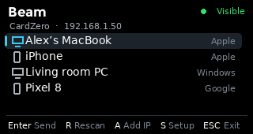
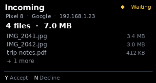
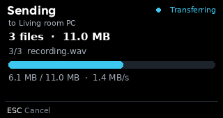
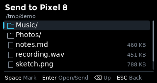

# Beam

Send and receive files with [LocalSend](https://localsend.org) on the M5Stack CardputerZero.

Beam is an APPLaunch app that speaks the open LocalSend protocol (v2, HTTPS), so the free LocalSend app on Android, iOS, Windows, macOS and Linux sees the Cardputer as one more device. Nothing goes through the cloud.

- **Receive**: open Beam and it appears in LocalSend under the Cardputer's name. Incoming files are shown with sender, names and sizes. Press Y to accept or N to decline, or set Beam to accept everything. Files and folders are saved to `~/Downloads`. Text messages pop up on screen.
- **Send**: devices on the same Wi-Fi are found by multicast. Pick one and send files and folders (Space marks several) or a text message. `A` adds a device by IP address or name, for networks without multicast such as Tailscale.
- Beam only runs while the app is open.

 
 

## Keys

| Key | Action |
|---|---|
| F / X | move |
| Enter | send to the device / open a folder / send the file |
| Space | mark a file or folder; Y sends everything marked |
| A | add a device by IP (`100.x.y.z`, `host:port`) |
| R | rescan |
| S | setup: name, ask first or accept all |
| Esc | back / exit |

## Install

From the CardputerZero AppStore, or on the device:

```sh
git clone https://github.com/InstantComet/cz-beam && cd cz-beam && sudo bash install.sh
```

Needs `python3-pil` and `python3-cryptography` (both on the stock image). The TLS certificate is generated on first start (`~/.config/cz-beam/`). Its SHA-256 is the LocalSend fingerprint.

## Protocol notes

- Discovery: UDP multicast `224.0.0.167:53317`, answered with `POST /api/localsend/v2/register`.
- Server: `register`, `info`, `prepare-upload`, `upload`, `cancel`. A single `text/*` file with a `preview` is treated as a message (204).
- LocalSend 1.18+ requires a client certificate (mTLS) when sending to it. Beam presents its own certificate.
- PIN-protected receivers and the browser download API are not supported.

## Testing without the LCD

```sh
python3 app/app.py --serve              # receive, log to stdout, accept everything
python3 app/app.py --send IP[:port] PATH|text:MESSAGE
python3 app/app.py --preview home out.png
```

Unofficial: Beam is an independent implementation of the LocalSend protocol and is not affiliated with or endorsed by the LocalSend project.

License: MIT
